# 🏸 ShuttlePro AI (badme-ai.vercel.app): รายการบั๊กจากคลิปทดสอบจริง + แผนแก้ไขสำหรับ AI ตัวถัดไป

> **อ่านก่อนเริ่มงาน:** ทำตาม `AGENTS.md` ด้วย คือเปิด/แก้เฉพาะไฟล์ที่เกี่ยวข้อง แก้แบบ patch ด้วย `edit_file` และ **ห้ามใส่ข้อมูลปลอม** (ผู้เล่นปลอม เส้นคอร์ทปลอม หรือสกอร์สุ่ม)
>
> วันที่วิเคราะห์: 2026-11-01 • คลิปที่ใช้อยู่ใน `badme-ai test clip/` (ใส่ไว้ใน `.gitignore` แล้ว เพราะรวมกัน ~830 MB)

---

## 0. การเก็บเวอร์ชันและการกู้คืน

| รายการ | ค่า |
|---|---|
| จุดกู้คืนก่อนเริ่มแก้ (git tag) | `v1.0.0-pre-fieldtest-fix` (ชี้ไปที่ commit `ee49def`) |
| คำสั่งกู้คืนทั้งโปรเจกต์ | `git checkout v1.0.0-pre-fieldtest-fix -- .` |
| คำสั่งกู้คืนทีละไฟล์ | `git checkout v1.0.0-pre-fieldtest-fix -- js/live-view.js` |
| ดูว่าแก้อะไรไปแล้ว | `git diff v1.0.0-pre-fieldtest-fix` |

**กติกาสำหรับ AI ตัวถัดไป**
1. แก้เสร็จแต่ละกลุ่ม (A, B, C …) ให้ commit แยกกัน แล้วติด tag เช่น `v1.0.1-fix-A`, `v1.0.2-fix-B`
2. เพิ่มบันทึกลง `CHANGELOG.md` (ยังไม่มีไฟล์นี้ ให้สร้างใหม่) โดยระบุเวอร์ชัน วันที่ สิ่งที่แก้ และคำสั่งกู้คืน
3. เปลี่ยน cache-bust ใน `index.html` บรรทัด 1026–1032 (`?v=20261101r`) เป็นค่าใหม่ทุกครั้งที่ deploy
4. รัน `for f in js/*.js; do node --check "$f"; done` ก่อน commit ทุกครั้ง

---

## 1. สรุปสิ่งที่เห็นในคลิป

| คลิป | เนื้อหา | อาการที่พบ |
|---|---|---|
| `23.37.53.mov` (2:28, เดสก์ท็อป) | อัปโหลดคลิป `แมตช์_01_11_17_16-56298.MP4` แล้วดู Live | ① ความยาววิดีโอแสดงเป็น **`119309:13`** และแถบเลื่อนค้างอยู่ทางซ้ายตลอด ② สกอร์ขึ้นเองจาก 0-1 → 1-1 → 2-1 ด้วยการขานผิด **"NOT OVER NET"** ③ ชิปขานแต้ม "NOT OVER NET • แต้มทีม A" ค้างอยู่หลายนาที ④ ความเร็วลูกบน HUD เพี้ยน (243, 225, 211 km/h "Jump Smash") ทั้งที่ผู้เล่นยืนเฉย ๆ ⑤ ผู้เล่นที่ยืนนิ่งขึ้นความเร็ว 10–25 km/h ⑥ วงตำแหน่งเท้า (ring) เยื้องออกจากเท้าจริง |
| `23.41.11.mov` (1:13) | แท็บ "โค้ช AI" สร้างรายงาน | ⑦ **Markdown ไม่ถูกเรนเดอร์**: เห็น `##`, `|---|`, `---` เป็นข้อความดิบ ⑧ ตัวเลขในรายงานเป็นไปไม่ได้ เช่น ระยะวิ่งทีม A **745.1 m** ภายใน 5 นาที ลูกตบ 263 km/h หรือ "ติดเน็ต 2 ครั้ง" ทั้งที่เป็นการขานผิด (ขยะเข้า ขยะออก) |
| `23.44.41.mov` (2:34, จอแนวตั้ง) | อัปโหลดคลิป `…-60622.MP4` ตั้งเส้นสนาม และสแกนเส้น | ⑨ แต้มขึ้นเองด้วย "IN +0.2 ซม. ในเส้นข้างซ้าย • แต้มทีม B" แต่ที่ระบบจับเป็น "ลูก" จริง ๆ คือไม้แบดของผู้เล่น ⑩ **พอเริ่มลากจุดตั้งเส้นสนาม ภาพค้างทั้งจอที่ 03:44** แต่นาฬิกาแมตช์ยังเดินต่อ เส้นที่ได้จึงไม่ตรงคอร์ท (ผู้ใช้ลากโดยมองไม่เห็นจุดขยับ) ⑪ กด "สแกนเส้นคอร์ท" แล้วขึ้นข้อความ "ล็อกเส้นสนามตามพิกัดมาตรฐานเรียบร้อย" ซึ่งเป็นข้อความใน `catch` แปลว่าการสแกน **error ทุกครั้ง** ⑫ เส้นสนามอัตโนมัติ (สีเขียว) เบี้ยวมาก ⑬ ความเร็วผู้เล่นค้างอยู่ตอนวิดีโอหยุด (B1 21.7 km/h) |

---

## 2. รายการบั๊กพร้อมสาเหตุและวิธีแก้ (เรียงตามความสำคัญ)

### 🔴 A. render loop พังขณะลากจุดตั้งเส้นสนาม และปุ่มสแกนเส้นใช้ไม่ได้ (อาการ ⑩ ⑪) ✅ แก้ไปแล้วบางส่วน
- **ไฟล์:** `js/live-view.js`
- **สาเหตุ:** โค้ดอ้างถึงตัวแปร `uploadedVideo` ซึ่งไม่ได้ประกาศไว้ที่ไหนเลย (คลิปที่อัปโหลดเล่นผ่าน `<video id="webcamVideo">` ตัวเดียวกับกล้อง)
  - ใน `drawCalibrationHandlesAndLoupe()` (ประมาณบรรทัด 1537): ทันทีที่ลากจุดในโหมดคลิป จะเกิด `ReferenceError` และ error นี้หลุดออกจาก `renderLiveScene()` ไปถึง `animateLoop()` ทำให้ไม่มีการเรียก `requestAnimationFrame(animateLoop)` อีก **loop จึงหยุดถาวร** ผลคือภาพค้าง เวลาในแถบวิดีโอค้าง และระบบหยุดตรวจจับทั้งหมด
  - ใน `triggerAutoSnapCourtCV()` (ประมาณบรรทัด 873): error เดียวกัน ทำให้ตกเข้า `catch` ทุกครั้ง
- **สิ่งที่ทำไปแล้ว:** เปลี่ยนทั้งสองจุดให้ใช้ `webcamVideo` ข้อความ toast บอกผลตามจริงแล้ว และถ้าสแกนสำเร็จจะเรียก `ShuttleCV.setCourtTrusted(true)`
- **สิ่งที่ยังต้องทำ:**
  1. ทำ `animateLoop()` (ท้ายไฟล์) ให้ทนต่อ error โดยเรียก `requestAnimationFrame(animateLoop)` ไว้ **บรรทัดแรก** และครอบ `renderLiveScene()` ด้วย `try { … } catch (e) { console.error(e); liveCtx.setTransform(1,0,0,1,0,0); }` (เพราะ `save()/clip()` ที่ไม่ได้ `restore()` จะทำให้ clip สะสมไปเรื่อย ๆ)
  2. ใน `toggleCourtCalibrationMode()` ตอนกดบันทึก (ส่วน `else`) ให้เรียก `ShuttleCV.setCourtTrusted(true)` ด้วย
  3. แนะนำเพิ่มเติม: ตอนเข้าโหมดตั้งเส้นในคลิป ให้ `webcamVideo.pause()` แล้ว `play()` ต่อหลังบันทึก จุดจะได้ไม่วิ่งหนีเฟรม
- **วิธีทดสอบ:** อัปโหลดคลิป เปิดเมนูแล้วกด "ตั้งเส้นสนาม" ลากจุด TL ภาพต้องไม่ค้าง แว่นขยาย 3x ต้องโผล่ และจุดต้องขยับตามนิ้ว จากนั้นกด "สแกนเส้นคอร์ท" ต้องไม่ขึ้นข้อความ "ตามพิกัดมาตรฐาน"

### 🔴 B. ความยาววิดีโอเป็น `119309:13` และแถบเลื่อนไม่ขยับ (อาการ ①)
- **ไฟล์:** `js/live-view.js` (`handleVideoUpload` ประมาณบรรทัด 679–717, `animateLoop`, `seekUploadedVideo`) และ `js/state.js` (`formatTimeSec` บรรทัด 382)
- **สาเหตุ:** คลิปถูกอัดด้วยปุ่ม Record ของแอปเอง (MediaRecorder) ไฟล์แบบนี้ไม่มี duration ใน header ทำให้ `video.duration` เป็น `Infinity` หรือค่าใหญ่ผิดปกติ ผลที่ตามมาคือ
  - `currentTime / duration` ได้ 0 ตลอด แถบเลื่อนจึงค้างซ้าย
  - `loop = true` อาจใช้ไม่ได้ เพราะวิดีโอหาจุดจบไม่เจอ และน่าจะเป็นอีกเหตุผลที่ภาพค้างตอนท้ายคลิป
- **วิธีแก้:**
  1. ใน `onloadedmetadata`: ถ้า `!isFinite(webcamVideo.duration) || webcamVideo.duration > 36000` ให้สั่ง `webcamVideo.currentTime = 1e101` แล้วรอ event `durationchange` (หรือ `timeupdate`) ครั้งแรก จากนั้นตั้ง `currentTime = 0` แล้วค่อยอัปเดต `videoDurTime` และเริ่ม `play()`
  2. สร้าง helper `getSafeVideoDuration()` ที่คืนค่า duration ถ้าเป็นค่า finite และ > 0 ไม่อย่างนั้นคืน `0` แล้วใช้แทน `webcamVideo.duration` ทุกจุด (`animateLoop`, `seekUploadedVideo`)
  3. แก้ `formatTimeSec(sec)` ให้คืน `'--:--'` เมื่อ `!isFinite(sec) || sec < 0` และรองรับรูปแบบ `h:mm:ss` เมื่อเกิน 3600 วินาที
  4. เพิ่ม listener `webcamVideo.addEventListener('ended', …)` สำหรับโหมดคลิป: ตั้ง `currentTime = 0` แล้ว `play()` และ reset shuttle track (ดูข้อ D)
  5. แก้ที่ต้นทางด้วย: ใน `finalizeAndSaveRawVideo()` ไฟล์ WebM ที่อัดได้ไม่มี duration (ถ้าจะแก้ ใช้ไลบรารีอย่าง `fix-webm-duration` โดยส่งค่า `Date.now() - rawRecStartTime`)

### 🔴 C. แต้มขึ้นเองจากการขานผิด (NOT OVER NET / IN) และชิปค้าง (อาการ ② ③ ⑨)
- **ไฟล์:** `js/scoreboard.js` (`evaluateRallyEndAndAutoScore`), `js/pose-tracker.js` (`handleTrackEnd`, `processRealShuttleAndRally`), `js/live-view.js` (`handleVideoUpload`), `js/cv-court.js`
- **สาเหตุ:**
  1. ตอนโหลดคลิป `handleVideoUpload` สั่ง `ShuttleCV.setCourtLocked(true)` ทันที โดยใช้ **มุมคอร์ท default ที่เดาไว้** ถ้า refine ไม่ผ่าน ระบบก็ยังขานแต้มด้วยเรขาคณิตที่ผิด
  2. `evaluateRallyEndAndAutoScore()` จะให้ฝ่ายตรงข้ามได้แต้ม "NOT OVER NET" ทุกครั้งที่ลูก "ตก" อยู่ฝั่งผู้ตีเอง ซึ่งเกิดบ่อยมากเวลาจับผิดเป็นไม้ เงา หรือลูกที่วางอยู่บนพื้น
  3. ถ้าไม่รู้ว่าใครตี (`lastHitterTeam` เป็น null) โค้ดจะเดาจาก `firstPt.v < 0.5` ซึ่งเดามั่ว
  4. ไม่มีช่วงพักหลังขานแต้ม คนเก็บลูกหรือตีเล่นตอนเตรียมเสิร์ฟจึงกลายเป็นแต้มใหม่ได้
  5. `lastCallText` ไม่ถูกล้างเลย ชิปจึงค้างหลายนาที
- **วิธีแก้:**
  1. **ทำ flag "คอร์ทน่าเชื่อถือ"** (เพิ่มไว้แล้ว): `ShuttleCV.setCourtTrusted()` / `ShuttleCV.isCourtTrusted()` ใน `cv-court.js` โดยจะเป็น true เมื่อผู้ใช้ลากตั้งเส้นเอง (`isManuallyEdited`) หรือเมื่อ refine สำเร็จ
     - ใน `handleVideoUpload` ที่ `setTimeout(… refineCourtToLines …)`: ถ้า `res.ok` ให้ `setCourtTrusted(true)` ไม่อย่างนั้นให้ toast ว่า "กรุณาตั้งเส้นสนามก่อน ระบบจะยังไม่ให้แต้มอัตโนมัติ"
     - ตอนอัปโหลดคลิปใหม่ หรือ `resetCornersDefault` ให้ `setCourtTrusted(false)`
  2. ใน `evaluateRallyEndAndAutoScore()`:
     - ถ้า `!ShuttleCV.isCourtTrusted()` ให้ **ไม่ให้แต้ม** แค่ `showToast('ตรวจพบลูกตก (ยังไม่ได้ตั้งเส้นสนาม) • กด +/- เพื่อให้แต้มเอง')`
     - ถ้า `!shuttle.lastHitterTeam` ให้ **ไม่ให้แต้ม** (ห้ามเดาจาก `firstPt.v`)
     - ให้ขาน NET/NOT OVER NET ได้เฉพาะเมื่อจุดตกอยู่ฝั่งผู้ตีและห่างเน็ตไม่เกิน ~1.5 m (`Math.abs(v-0.5)*13.4 <= 1.5`) ซึ่งเป็นกรณีลูกชนเน็ตแล้วร่วงจริง ถ้าตกฝั่งผู้ตีแต่ไกลเน็ต ให้ถือว่า "ไม่แน่ใจ" แล้วไม่ให้แต้ม
     - ใส่ cooldown: เก็บ `scoreboard.lastAutoCallMs` และไม่ให้แต้มอัตโนมัติซ้ำภายใน 5000 ms
  3. ใน `handleTrackEnd()` (pose-tracker.js ประมาณบรรทัด 443): ตั้ง `pendingRallyEnd` ได้เฉพาะเมื่อ track มีจุดจริง (`!inpainted`) ≥ 6 จุด ลูกกำลังลง (`descending`) และ `activeShot.hitter` ไม่เป็น null
  4. **ล้างชิปที่ค้าง:** ใน `awardPointBWF` เก็บ `scoreboard.lastCallAtMs = performance.now()` แล้วใน `animateLoop` หรือ `updateLiveHUD` ตรวจว่าถ้า `rallyState === 'POINT_CALL'` และผ่านไปเกิน 6000 ms ให้ตั้ง `rallyState = 'WAITING'`, `lastCallType = 'IDLE'`, `lastCallText = 'รอเสิร์ฟ (พร้อมตรวจจับอัตโนมัติ)'` แล้ว `updateScoreboardUI()`
  5. (ทางเลือกด้าน UX) เพิ่มสวิตช์ "ให้แต้มอัตโนมัติ / ยืนยันก่อน" ใน More sheet (`index.html`) โหมดยืนยันจะขึ้น toast พร้อมปุ่ม ✓/✗ ก่อนบวกแต้ม

### 🟠 D. ความเร็วลูกแบดเพี้ยน (243 km/h และค่าอื่น ๆ) และนาฬิกาที่ใช้คำนวณไม่ถูก (อาการ ④)
- **ไฟล์:** `js/pose-tracker.js` (`finalizeShot` บรรทัด 410–441, `measureTrackInitialSpeedMps`, `processRealShuttleAndRally`) และ `js/live-view.js` (`renderLiveScene` บรรทัด 1363–1368)
- **สาเหตุ:**
  1. **นาฬิกา:** ทุกอย่างใช้ `performance.now()` แต่ render loop วิ่ง ~100 fps (เห็นใน badge "97fps") ขณะที่คลิปมีแค่ 30 fps CV จึงประมวลผล**เฟรมเดิมซ้ำ** frame-diff ได้ 0 track จึงขาด ๆ หาย ๆ และต้อง inpaint มั่ว นอกจากนี้ dt ไม่ตรงกับเวลาในวิดีโอเมื่อหยุด/seek/เปลี่ยนความเร็ว 0.5x/1.5x
  2. `finalizeShot` ยอมรับค่าจาก `vDrag` แม้ `vTrack = 0` (บรรทัด 430: `vDrag * 0.85`) แปลว่ามีแค่เวลาบินกับระยะที่ "เดา" ก็ได้ความเร็วมาแล้ว และยังมี `wristBoost` คูณเพิ่มอีก
- **วิธีแก้:**
  1. ใน `live-view.js` เพิ่มตัวแปร global `let frameClockMs = 0; let lastProcessedMediaTime = -1;` แล้วใน `renderLiveScene()` ก่อนเรียก CV:
     ```js
     const mt = webcamVideo.currentTime;
     const isNewFrame = mt !== lastProcessedMediaTime;
     if (isUploadedVideoActive && (mt < lastProcessedMediaTime || mt - lastProcessedMediaTime > 0.5)) {
         resetShuttleTracker(); // seek หรือวนคลิปใหม่: ล้าง shuttleTrack/activeShot/pendingRallyEnd
     }
     if (!isTrackingPaused && isNewFrame) {
         lastProcessedMediaTime = mt;
         frameClockMs = isUploadedVideoActive ? mt * 1000 : performance.now();
         runRealPoseEstimation(webcamVideo);
         const cvRes = ShuttleCV.analyzeVideoFrameCV(webcamVideo, detectedHumanBoxes);
         processRealShuttleAndRally(cvRes);
         updateCVConfidenceBadges();
     }
     ```
     (ถ้า browser รองรับ `requestVideoFrameCallback` ใช้ `metadata.mediaTime` จะแม่นกว่า)
  2. ใน `pose-tracker.js` เพิ่ม `function trackerNow() { return typeof frameClockMs === 'number' && frameClockMs > 0 ? frameClockMs : performance.now(); }` แล้วแทน `performance.now()` ใน `runRealPoseEstimation` และ `processRealShuttleAndRally` ให้ timestamp ทุกตัวใน tracker เป็นนาฬิกาเดียวกัน ต้องเพิ่ม `resetShuttleTracker()` ด้วย
  3. ใน `finalizeShot`:
     - ถ้า `vTrack <= 0` ให้ `return` (ไม่รายงานความเร็วถ้าไม่มีความเร็วพิกเซลที่วัดได้จริง)
     - ตรวจว่าสองวิธีให้ค่าใกล้กัน: `const ratio = Math.max(vDrag, vTrack) / Math.min(vDrag, vTrack); if (ratio > 1.8) return;`
     - ลด `wristBoost` สูงสุดเหลือ 1.05 หรือลบทิ้ง
     - เพดาน 265 km/h ยังคงไว้ได้ แต่ควรเพิ่ม: track ต้องมีจุดจริง ≥ 5 จุด
  4. ใน `drawRealShuttleAndHawkeye` (live-view.js) ให้แสดงตัวเลขความเร็วข้างลูกเฉพาะเมื่อ `shuttle.speedKmh > 0` และวัดได้ภายใน 2 วินาทีล่าสุด ไม่อย่างนั้นค่าเก่าจะติดไปกับลูกที่จับได้ใหม่
  5. HUD มุมขวาบน (ตัวเลขใหญ่ km/h) ควรจางลงหรือขึ้นป้าย "ล่าสุด" เมื่อค่านั้นเก่ากว่า ~5 วินาที

### 🟠 E. ความเร็วและระยะวิ่งของผู้เล่นเพี้ยน (ยืนนิ่งแต่ขึ้น 20 km/h, ระยะ 745 m) (อาการ ⑤ ⑧ ⑬)
- **ไฟล์:** `js/pose-tracker.js` (`updatePlayerSlot` บรรทัด 173–213)
- **สาเหตุ:** ตำแหน่งข้อเท้าจาก MoveNet (input แค่ 384 px) สั่นทุกเฟรม โดยเฉพาะผู้เล่นฝั่งไกล ซึ่ง 1 px เท่ากับหลายสิบเซนติเมตร โค้ดปัจจุบันตั้งเกณฑ์ขั้นต่ำไว้แค่ `stepM >= 0.03` (3 cm) และคำนวณความเร็วจาก dt แค่ ~40 ms ผลคือการสั่นถูกนับเป็นการวิ่ง ระยะสะสมไปเรื่อย ๆ และความเร็วกระโดด
- **วิธีแก้:**
  1. เก็บประวัติตำแหน่งแบบมีเวลา `slot._hist = [{u, v, t}]` ไว้ประมาณ 0.6 s แล้วคำนวณความเร็วจาก **การเคลื่อนที่สุทธิในช่วง ~0.5 s** (`dist(hist[0], hist[last]) / (tLast - t0)`) แทนการใช้ทีละเฟรม
  2. ทำ deadband ตามความลึก: `noiseM = 0.10 + 0.25 * (1 - v)` (ฝั่งไกลยอมให้สั่นได้มากกว่า) ถ้าการเคลื่อนที่สุทธิในหน้าต่างน้อยกว่า `noiseM` ให้ถือว่าความเร็วเป็น 0
  3. นับระยะสะสมเฉพาะจาก "จุด anchor": บวกระยะเมื่อห่างจาก anchor ล่าสุดเกิน `noiseM` แล้วย้าย anchor มาที่จุดใหม่ (กันการสั่นไปมา)
  4. ใช้ One-Euro filter หรือ EMA ที่ขึ้นกับ dt แทน `alpha = 0.6` ที่ fix ไว้
  5. ลดเพดาน `Math.min(32, …)` เหลือ ~28 km/h (ผู้เล่นแบดระดับสูงวิ่งได้ราว 20–25 km/h)
  6. ถ้าไม่มีการประมวลผลเฟรมใหม่ (วิดีโอหยุด) ห้ามแสดงความเร็วค้าง ให้แสดง "—" หรือ 0 เมื่อ `trackerNow() - lastSeenMs > 800` (ข้อ D จะแก้ส่วนนี้ให้เกือบหมดแล้ว)
- **เกณฑ์ผ่าน:** ผู้เล่นที่ยืนนิ่ง 5 วินาทีต้องได้ < 2 km/h ระยะสะสมใน 5 นาทีของเกมคู่สมเหตุสมผล (คนละ ~150–400 m) และรายงาน AI ต้องไม่ขึ้น 745 m อีก

### 🟠 F. แบ่งทีม A/B ผิดและจับคนนอกคอร์ท (อาการ ⑥ และป้ายชื่อสลับ)
- **ไฟล์:** `js/pose-tracker.js` (`evaluatePoseCandidate` บรรทัด 118–121, `runRealPoseEstimation`)
- **สาเหตุ:**
  - `const team = (uv.y <= 0.5 || footY <= 0.5) ? 'A' : 'B';` ใช้ **OR** กับตำแหน่งบนจอ ใครที่เท้าอยู่ครึ่งบนของจอจะถูกนับเป็นทีม A ทันที ถึงจะยืนอยู่ฝั่งใกล้ก็ตาม (กล้องแนวตั้งที่คอร์ทอยู่ครึ่งล่างของจอเจอปัญหานี้หนัก)
  - comment ที่หัวไฟล์บอกว่ามี "STRICT in-court gating" แต่โค้ดจริงไม่ได้กรองคนนอกคอร์ทเลย (คนดูข้างสนามกับคนที่สนามข้าง ๆ ถูกจับไปด้วย)
- **วิธีแก้:**
  1. ถ้า `ShuttleCV.isCourtTrusted()` ให้แบ่งทีมจาก `uv.y` อย่างเดียว ใช้ `footY` เป็น fallback เฉพาะตอนที่คอร์ทยังไม่น่าเชื่อถือ
  2. กรองคนนอกคอร์ท: `if (isCourtTrusted && !ShuttleCV.isInsideCourt(uv.x, uv.y, IN_COURT_TOL_U + 0.08, IN_COURT_TOL_V + 0.05)) return { mask: box, player: null };` (ยังคืน mask ไว้ให้ shuttle detector ใช้ตัดคนออก)
  3. ใน `assignCandidatesToSlots` ถ้า candidate ห่างจาก slot เดิมเกิน 3 m ภายใน 200 ms ให้ถือว่าเป็นคนละคน (กัน ID กระโดดข้ามคน)
- **วงเท้าเยื้อง (⑥):** `slot.screenX/Y` มาจาก `footX/footY` ของเฟรมล่าสุด แต่ `u/v` ผ่านการ smooth ทำให้สองค่าไม่ตรงกัน ให้ใช้ค่าเดียวกันในการวาด (แนะนำวาดจาก `courtNormalizedToScreen(u, v)` เมื่อคอร์ทน่าเชื่อถือ ไม่อย่างนั้นใช้ foot ที่ smooth แล้ว)

### 🟡 G. รายงานโค้ช AI ไม่เรนเดอร์ Markdown และมีความเสี่ยง XSS (อาการ ⑦)
- **ไฟล์:** `js/analytics-coach.js` มี 3 จุด: บรรทัด 641–643 (`renderCoachPreviewStandby`), 677–679 (cached), 734–736 (ผลลัพธ์ใหม่) ทั้งสามจุดแปลงแค่ `**bold**` กับ `\n` → `<br>`
- **ปัญหา:** หัวข้อ `##`, ตาราง `| a | b |`, เส้น `---`, รายการ `* ` / `1. ` แสดงเป็นข้อความดิบ และข้อความจาก AI ถูกใส่ลง `innerHTML` **โดยไม่ escape** (XSS)
- **วิธีแก้:** เขียนฟังก์ชันเดียว `renderMarkdownSafe(md)` แล้วใช้แทนทั้ง 3 จุด
  1. escape ก่อนทุกอย่าง: `& < > " '` → entity
  2. วนทีละบรรทัด:
     - `^#{1,4}\s` → `<h3/h4 class="text-emerald-300 font-bold mt-4 mb-1">`
     - `^---+$` → `<hr class="border-slate-800 my-3">`
     - บรรทัดที่ขึ้นต้นด้วย `|` ติดกันหลายบรรทัด → `<table class="w-full text-[11px] border-collapse">` (ข้ามแถว `|---|`, แถวแรกเป็น `<th>`, เซลล์ใส่ `border border-slate-800 px-2 py-1`)
     - `^[*-]\s` → `<ul class="list-disc pl-5">`, `^\d+\.\s` → `<ol class="list-decimal pl-5">`
     - บรรทัดว่างคือจบย่อหน้า
  3. inline: `**x**` → `<strong class="text-emerald-300">`, `` `x` `` → `<code>`, `*x*` → `<em>`
  4. `renderSavedMatchesList` บรรทัด 1322 ให้ตัดสัญลักษณ์ markdown ออกให้หมด (`#`, `|`, `*`) ก่อนนำไปทำ snippet
- **อย่าใช้ CDN markdown lib เพิ่ม** ถ้าไม่จำเป็น (แอปโหลด CDN หลายตัวอยู่แล้ว) แต่ถ้าจะใช้ ต้องใช้ `marked` คู่กับ `DOMPurify`

### 🟡 H. ข้อมูลที่ส่งให้ AI ต้องผ่านการตรวจความสมเหตุสมผล (อาการ ⑧)
- **ไฟล์:** `js/analytics-coach.js` (`buildStructuredMatchDataJSON` ประมาณบรรทัด 420–460)
- **วิธีแก้:** ใส่ field `data_quality` ใน JSON เช่น `{ court_trusted: bool, auto_calls_count, manual_calls_count, warnings: [] }` และกรองค่าที่เป็นไปไม่ได้ก่อนส่ง (ระยะวิ่งต่อคนต่อนาที > 120 m, ความเร็วผู้เล่น > 28 km/h, ลูกตบ > 265) โดยใส่เป็น warning ใน `knowledge/system-prompt.md` ให้เพิ่มกติกาว่า "ถ้า `court_trusted=false` หรือมี warnings ห้ามสรุปเป็นข้อเท็จจริง ให้แจ้งว่าข้อมูลไม่น่าเชื่อถือ"

### 🟡 I. เส้นสนามอัตโนมัติเบี้ยว (อาการ ⑫)
- **ไฟล์:** `js/cv-court.js` (`refineCourtToLines` บรรทัด 665–840)
- **สาเหตุ:** refine ทำได้แค่ "ดูด" จากตำแหน่งเดิมไม่เกิน `maxShift 0.08` ถ้าเริ่มจากมุม default ที่ห่างคอร์ทจริงมาก ก็ refine ไม่ได้หรือดูดผิดเส้น และไม่มีขั้นตอนค้นหาคอร์ทแบบ global (เช่น Hough หาเส้นแล้วจับคู่ intersection กับโมเดลคอร์ท)
- **วิธีแก้ (ระยะสั้น):** ถ้าผลไม่ผ่าน ให้ toast บอกผู้ใช้ให้ตั้งเส้นด้วยมือ (ทำไปแล้วในข้อ A) และห้ามตั้ง trusted
- **วิธีแก้ (ระยะยาว):** หาเส้นขาวด้วย ridge/Hough บน ROI พื้นคอร์ท → จัดกลุ่มเป็นเส้นแนวนอน/แนวลึก → ลองจับคู่ 4 intersection กับโมเดล BWF แล้วเลือก H ที่ RMS ต่ำสุด → จากนั้นใช้ `refineCourtToLines` เดิมเป็นขั้นปรับละเอียด

### 🟢 J. การตั้งเส้นสนาม: UX และป้ายชื่อจุด
- **ไฟล์:** `js/live-view.js` (`drawCalibrationHandlesAndLoupe` บรรทัด 1494)
- จุด `bl/br` ใน `cv-court.js` คือ **เส้นเสิร์ฟสั้นฝั่งใกล้** (v = 0.6478) ส่วน `tl/tr` คือ **เส้นหลังฝั่งไกล** (v = 0) ป้ายชื่อยังไม่บอกตรง ๆ ว่าเป็น "ฝั่งไกล/ฝั่งใกล้" ผู้ใช้จึงสับสน ควรเปลี่ยนเป็น `เส้นหลังฝั่งไกล-ซ้าย (TL)` และ `เส้นเสิร์ฟสั้นฝั่งใกล้-ซ้าย (SL)` และระหว่างลากควรวาดเส้นคอร์ทแบบ real-time ให้เห็นว่าทาบตรงหรือยัง (ตอนนี้วาดอยู่แล้วผ่าน `drawHomographyCourtAndNet` แต่ก่อนหน้านี้มองไม่เห็นเพราะ loop พังจากข้อ A)
- ในคลิป จุด Net-L/Net-R ถูกวางต่ำกว่าแถบเน็ตจริง ~60 px เพราะผู้ใช้มองไม่เห็นภาพตอนลาก (ข้อ A) แก้ข้อ A แล้วควรทดสอบซ้ำ

---

## 3. ลำดับงานที่แนะนำ

```mermaid
flowchart LR
    A["A: loop crash ✅ บางส่วน"] --> B["B: duration Infinity"]
    B --> D["D: frame clock + speed validation"]
    D --> C["C: auto-score gating + ชิปค้าง"]
    C --> E["E: player speed/distance"]
    E --> F["F: team split + in-court gating"]
    F --> G["G: markdown renderer"]
    G --> H["H: data_quality ใน JSON"]
    H --> I["I: global court detection (ระยะยาว)"]
```



## 4. สถานะ ณ ตอนส่งต่องาน

| ไฟล์ | สิ่งที่เปลี่ยนแล้ว (ยังไม่ commit) |
|---|---|
| `js/live-view.js` | `uploadedVideo` → `webcamVideo` 2 จุด (loupe + auto-scan), ข้อความ toast ตอนสแกนสำเร็จ/ล้มเหลวตามจริง, เรียก `ShuttleCV.setCourtTrusted(true)` เมื่อสแกนสำเร็จ |
| `js/cv-court.js` | เพิ่ม `let isCourtTrustedFlag`, `setCourtTrusted()`, `isCourtTrusted()` (ยังไม่มีใครเรียก `isCourtTrusted()` ต้องทำต่อในข้อ C และ F) |
| `.gitignore` | เพิ่ม `badme-ai test clip/` |

ผ่าน `node --check` ครบทุกไฟล์แล้ว **ยังไม่ได้ commit**: งานแรกของ AI ตัวถัดไปคือ `git add -A && git commit -m "fix(live): uploadedVideo ReferenceError (calibration freeze, auto-scan) + court trusted flag" && git tag v1.0.1-fix-A`

## 5. Checklist ทดสอบซ้ำด้วยคลิปเดิม (ต้องผ่านทุกข้อ)
- [ ] อัปโหลด `…-56298.MP4`: ความยาวเป็นเวลาจริง แถบเลื่อนขยับ seek ได้ และวนคลิปได้
- [ ] ยังไม่ตั้งเส้น: **ไม่มีแต้มขึ้นเอง**
- [ ] ตั้งเส้นสนาม: ภาพไม่ค้าง แว่นขยายทำงาน และเส้นเหลืองทาบเส้นขาวได้
- [ ] สแกนเส้นคอร์ท: ข้อความบอกผลตามจริง (สำเร็จ/ไม่สำเร็จ)
- [ ] ผู้เล่นยืนนิ่ง < 2 km/h และไม่มีป้ายชื่อบนคนดูข้างสนาม
- [ ] ความเร็วลูกไม่ขึ้นตอนไม่มีการตี และไม่มีค่า > 265
- [ ] ชิปขานแต้มหายเองภายใน ~6 วินาที
- [ ] รายงานโค้ช AI: หัวข้อ ตาราง และเส้นคั่นแสดงผลถูกต้อง ไม่มี `##` หรือ `|` หลุดมา
- [ ] หยุดวิดีโอแล้ว ความเร็วไม่ค้าง
